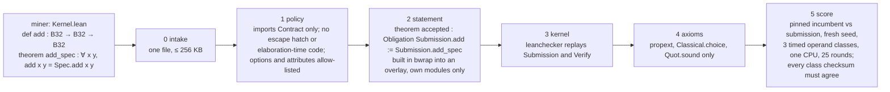

# FloatLib kernel competition

## Quick Summary

- A proof-gated speed competition on [FloatLib](https://github.com/lean-dojo/FloatLib)'s verified floating-point kernels. A miner submits one Lean file: a binary32 addition `Submission.add` and a proof that it equals `ExecFloat.Spec.add` on every pair of inputs, NaNs, infinities and signed zeros included. The gate checks the proof, re-checks it in the Lean kernel, audits axioms, then times the kernel against the incumbent. Lower time wins.
- The incumbent is FloatLib's own certified kernel, `ExecFloat.add`. The best proven kernel so far, `kernels/add/tuned`, runs at **0.50x** of its time (`fastlog` 0.53x); an unproved textbook adder reaches **0.40x**.
- **Miners: read [`MANUAL.md`](MANUAL.md)** for setup, what to submit, how to measure, what to prove and what gets rejected. This README is the overview for operators and reviewers.
- Five slots share one gate: binary32 `add` (the main one; best proven 0.50x), `mul` (best proven `mul/fast`, 0.55x), `fma`, `div` and `sqrt`, each with its own pinned obligation, incumbent and operand classes (`gate.py --slot mul|fma|div|sqrt`). The validator service accepts all five, and all five pay: the competition's share is split equally across them, each slot's admitted leader taking its fifth.
- One command sets up a fresh clone (about 15 minutes); one command tests the whole environment against 34 expected verdicts across the five slots (about 15 minutes).
- A validator service is included: miners submit signed kernels over HTTP (`miner/submit.py`), a worker runs the gate, and a leaderboard ranks them.

```bash
git clone <this repo> && cd conjectures-floatlib-competition
./setup.sh                                          # elan + Lean v4.34.0, FloatLib + Mathlib, build, .venv
export PATH=$HOME/.elan/bin:$PATH
.venv/bin/python selftest.py                        # 34/34 cases as expected = ready
.venv/bin/python gate.py kernels/add/fastlog        # intake, policy, statement, kernel, axioms, score
.venv/bin/python gate.py --bench my-kernel          # time an unproved kernel; never a verdict
.venv/bin/python gate.py --slot mul kernels/mul/incumbent   # the multiplication slot
```

## How the gate works



Every run writes `logs/gate-<utc>.log` (every command and its exit code) and one
`results/<slot>-<submission>-<mode>-<utc>.json` verdict: the stage reached, the reason, the seed, the
ratio, per-class nanoseconds and spreads, and the sha256 of the pinned incumbent binary.

## The ladder

The `add` kernels in `kernels/add/`; same seed, 500k pairs per operand class, 25 rounds, one CPU:

| kernel | what | verdict | time vs incumbent |
|---|---|---|---|
| `incumbent` | `ExecFloat.add`, proof `add_eq_spec` | accepted | 1.00x |
| `word` | `Configured.Backend.wordAdd` called directly | accepted | 1.00x: dispatch is free |
| `direct` | the word kernel `addFiniteImpl?` on raw bits, no carrier codec | accepted | 0.80x |
| `mirror` | `addFiniteImpl?` step for step on bare words, no `Option` or `Model` | accepted | 0.78x |
| `fastlog` | `mirror` with a binary-search `log2` in `roundProduct` | accepted | 0.53x |
| `tuned` | `fastlog` with a one-compare special test and a rounding step on machine words | accepted | **0.50x** |
| `textbook-unproved` | guard/round/sticky adder, specials to `ExecFloat.add` | rejected at policy (`sorry`) | 0.40x with `--bench` |
| `wrong` | subtraction with the addition theorem | rejected at statement | |
| `cheat` | the host FPU with `native_decide` | rejected at policy | |

Where the incumbent's time goes: the carrier codec and the `Option`/`Model` wrappers around the
word kernel cost about 20%; `UInt64.log2`, which the runtime computes one bit at a time, about 30%.
None of the four accepted faster kernels needed new floating-point reasoning: each proves it
equals `wordAdd` and reuses `wordAdd_eq_spec`. Below 0.50x the cost is the algorithm itself, and
beating it means proving a new rounding argument, FloatLib's own being 563 lines.

## Security model

| threat | defence |
|---|---|
| a proof that does not prove the obligation | the gate's own `theorem accepted : Obligation Submission.add := Submission.add_spec` must typecheck |
| `sorry`, `native_decide`, custom axioms | `#print axioms accepted` must list only Lean's three |
| a forged compiled `.olean` whose proof never passed the kernel | `leanchecker` replays every declaration of `Submission` and `Verify` through the kernel |
| miner code running during the build (`#eval`, `run_cmd`, macros, `@[command_elab]`, `initialize`) | policy bans them, and every build and bench runs in bwrap: read-only root, no network |
| a build-time file read reaching a secret (`include_str`, and any read at all) | policy bans `include_str`; the sandbox hides the real HOME (the validator wallet) and the repo root (its `.env`, its stored submissions) behind tmpfs and restores only the toolchain and the Lean workspace read-only, and the build runs with a minimal environment, not the validator's |
| a build or bench exhausting the validator's memory or process table | every sandboxed command runs in a systemd scope: 4096 MB for builds and kernel checks, 512 MB for benches, no swap, 256 tasks; the OOM kill rejects the submission, and a host that cannot apply the caps fails the gate as a validator error |
| a build overwriting trusted files | builds write into a throwaway overlay; any file there not stemmed `Submission`, `Verify`, `Main` or `bench` rejects; FloatLib and Mathlib sit read-only under `.lake/packages` |
| slowing the incumbent (`csimp`, `@[export]`) | the incumbent is a separate binary built from `kernels/add/incumbent` and pinned, rebuilt only when its sources change |
| tuning for known operands | a fresh seed per run; three timed classes (near-one, wide-gap, cancellation) plus raw bit patterns checksummed |

`kernels/exploits/*` has one file per threat. Nine are rejected at policy, and the two that
matter most are also rejected by the later stages when policy is skipped: `exploits/forge` at
`kernel`, `exploits/tamper` at `statement`. `exploits/membomb` is proved and correct but allocates
gigabytes per call; the bench memory cap rejects it at `score`. `selftest.py` runs all of these.

## Timing

Incumbent and submission run as separate processes, alternating over 25 rounds, each round the
fastest of 3 in-process sweeps, pinned to one CPU with `taskset`. The incumbent against itself
reads 0.997 to 1.006x over four runs; with 9 rounds it swung to 0.956x, and unpinned it drifts by
about 3%. A 3% promotion bar needs the 25 rounds and the pinned CPU. Knobs: `BENCH_SEED`,
`BENCH_ROUNDS`, `BENCH_PAIRS`, `BENCH_CPU`, `GATE_SANDBOX`, `GATE_BUILD_MEMORY_MB`,
`GATE_BENCH_MEMORY_MB`, `GATE_TASKS_MAX`; `LOG_LEVEL` (INFO) sets the console, while `logs/`
keeps everything at DEBUG.

A one-hour study (`tools/timing_study.py`, 2026-09-24) alternated 86 full gate runs, each on a
fresh seed:

| submission | runs | mean | stdev | min | max | at or below 0.97 |
|---|---:|---:|---:|---:|---:|---:|
| `incumbent` against itself | 43 | 1.0005 | 0.0043 | 0.9932 | 1.0135 | 0 |
| `fastlog` | 43 | 0.5340 | 0.0044 | 0.5244 | 0.5563 | 43 |

No run of the incumbent against itself came near the 3% bar (closest 0.993, about 5 standard
deviations away), and `fastlog` cleared it every time. Single classes vary more than the total
(incumbent self-ratio per class 0.98 to 1.02), which is why the score sums all three.

`lake build micro && lean/.lake/build/bin/micro` breaks one addition down on the same operands:

| operands | loop only | host FPU (unchecked) | certified word kernel | `ExecFloat.add` | textbook adder |
|---|---|---|---|---|---|
| random bit patterns | 5.2 ns | 17.0 ns | 27.2 ns | 27.2 ns | 18.9 ns |
| near one | 5.2 ns | 8.4 ns | 32.5 ns | 32.6 ns | 15.3 ns |

## Running a validator

The gate runs on the host (it needs bubblewrap and the Lean toolchain); Postgres runs in
Docker; the API, the gate worker and the two chain workers run under pm2.

```bash
./setup.sh --chain                          # everything above, plus the service and the bittensor SDK
$EDITOR .env                                # POSTGRES_PASSWORD, the validator wallet, NETUID, BENCH_CPU
docker compose up -d db                     # Postgres 17 on 127.0.0.1:POSTGRES_PORT (default 5433)
docker compose up migrate                   # alembic upgrade head
pm2 start deploy/pm2.config.js              # the four floatlib-* processes below
curl http://127.0.0.1:9300/health           # {"ok":true,"queued":0,"promotion_bar":0.97}
```

Each process runs from `validator/` (`cd validator && python -m service.api`); pm2 sets that
directory itself and names them `floatlib-*`, so they sit beside another competition's on one host.

| process | what it does |
|---|---|
| `floatlib-submission-api` (`python -m service.api`) | the platform's layout on `SERVICE_PORT` (9300), one competition slug per slot (`floatlib` is add; `floatlib-mul`, `-fma`, `-div`, `-sqrt`): `POST /v1/competitions/{slug}/submissions` (signed `X-Conjectures-*` headers, one `Kernel.lean` part), `GET …/submissions/{id}`, `GET …/submissions/{id}/report`, `GET …/leaderboard`; plus `GET /health`, `GET /ready` |
| `floatlib-gate-worker` (`python -m service.worker`) | claims queued submissions oldest first, writes their `Kernel.lean` from the store, runs `gate.py <dir> --verdict` and stores the verdict and its full JSON as the report; exit 2 or no verdict is a validator error, requeued uncharged and behind fresh work; a submission the gate crashes on `SERVICE_MAX_GATE_ERRORS` times (3) ends in `error`; at startup it requeues the claims its previous run left; it backs off up to 5 minutes while errors repeat |
| `floatlib-chain-watcher` (`python -m workers.chain_watcher`) | streams subnet registrations into the store; without it nobody can submit |
| `floatlib-weight-setter` (`python -m workers.weight_setter`) | every tick, scores every slot's board (each slot's admitted leader takes an equal fifth of the competition's budget: `validator/admission.py` and the rule in `validator/reward.py`) and records the vector, its per-hotkey lines and the published snapshot; once an epoch, inside the margin before the boundary, it submits the vector unless in dry run |

**Weights.** The vector is the whole validator's, as in the DEFLATE competition
(`validator/treasury.py`): the treasury, uid 121 on netuid 66, takes 80%; the competition's 20% goes
to miners by score, and whatever the competition does not pay a registered miner goes to the
treasury. On netuid 66 both numbers are code constants, and an `.env` value that disagrees refuses
to start; off mainnet `WEIGHT_TREASURY_UID` and `WEIGHT_COMPETITION_SHARE` set them. A scoring
failure pays the treasury the whole epoch rather than skipping it. The epoch is timed from the
chain's own `LastMechansimStepBlock`.

**Dry run is the default** (`WEIGHT_DRY_RUN=1`): the setter records every vector and submits none.
Only one process may set weights per validator hotkey, and two would overwrite each other's vector
every epoch, so turn it off only once it is decided which competition's weight setter submits on
SN66. **Pausing a round** is `WEIGHT_BURN_MODE=1`: the competition's share burns to
`WEIGHT_BURN_UID` (default 121, the treasury itself) and the treasury is paid as usual.

**Changing the verifier** retires old verdicts. Every verdict carries the fingerprint of the
verifier it came from (`fingerprint.py`: a hash of `gate.py`, the contract, the Verify and bench
modules, the lakefile, manifest and toolchain, and the ratio-defining `BENCH_*` knobs), and only
the current fingerprint's accepted submissions rank or get paid. After an update, send the old
ones back through the gate; each keeps the registration it already spent:

```bash
.venv/bin/python fingerprint.py                # the current fingerprint
.venv/bin/python tools/reverify.py             # accepted submissions from another verifier
.venv/bin/python tools/reverify.py --apply     # requeue them for the gate worker
```

**Promoting a winner** is an operator step: copy the winning `Kernel.lean` somewhere stable, set
`GATE_INCUMBENT` to it in `.env` (`GATE_INCUMBENT_MUL`, `GATE_INCUMBENT_FMA` for the other slots),
and restart the gate worker. The gate rebuilds that slot's pinned binary under `pinned/<slot>/`
on its next run, and the leaderboard moves to the new incumbent's ratios.

### Serving through the conjectures platform

The add board is meant to be served by conjectures.io (`conjectures-validator`), the way DEFLATE
is: the platform queues submissions into this database and reads what the weight setter publishes,
while the gate, the chain watcher and the weight setter stay here. This repository's side is ready:

- the store keeps each `Kernel.lean` (`submission_files`), the gate's report, the platform account
  and the published snapshot (`weight_sets.api_snapshot`), from migration 0006;
- `deploy/platform/platform_api.sql` is the platform role's exact grants, `deploy/platform/grant.sh`
  creates the role (`PLATFORM_API_PASSWORD`) and resets them, and `deploy/platform/compose.yaml`
  attaches the database to the platform stack's network
  (`COMPOSE_FILE=compose.yaml:deploy/platform/compose.yaml`);
- miners sign the platform's message, and this API takes the platform's request.

The platform side is not: its competition adapter is written for DEFLATE's two files and
compression metrics, and it serves one competition per process.
[`deploy/platform/CONTRACT.md`](deploy/platform/CONTRACT.md) lists exactly what it must change, and
the emissions decision that comes with it. Until then miners submit to a FloatLib validator's API.

### Observability

With `AXIOM_TOKEN` and `AXIOM_DATASET` set, the four processes send structured events to the
platform's Axiom dataset in its envelope (`validator/axiom.py`, ported from DEFLATE), tagged
`competition: "floatlib"`: `service_started`/`stopped`/`misconfigured`, `submission_claimed`,
`gate_verdict`, `submission_requeued`, `gate_validator_error`, `registrations_recorded`,
`chain_read_failed`, `weights_planned`/`set`/`skipped`/`failed`, and every ERROR log line as
`log_error`. Without them events are off. Sending never blocks or raises.

The service layer is ported from our DEFLATE competition (`conjectures-optimisation-deflate`):
registrations and entitlement claims, the Postgres rate limiter, signed timestamps, the queue with
stale-claim recovery, the weight-setting audit trail, the treasury split, the platform's wire
contract and the Axiom events. What is new is the single-file submission, one slug per slot, the
ratio-based leaderboard per slot filtered to its current incumbent, and the per-slot king-of-the-hill
scorer in `validator/reward.py`.

```bash
# The tests: a scratch database on the compose Postgres, a stub gate, one real-gate test.
set -a; . ./.env; set +a
.venv/bin/python -m pytest -q                  # 139 tests, about 2 minutes
.venv/bin/python -m pytest -q -m "not slow"    # 138 tests, seconds
```

Without Docker, `tools/test-env.sh test` downloads a local Postgres into `~/.local/share` and runs
the same tests against it.

CI (`.github/workflows/ci.yml`) runs ruff and the fast tests against a Postgres service container
on every push and pull request, and nightly (or on demand) the whole `setup.sh`, the real-gate
test and the self-test. A hosted runner has no user systemd session, so that job lifts the gate's
memory caps; everything else runs as on a validator.

## Stage 2 draft: tensor kernels

Stage 2 adds tensor slots next to stage 1's scalar ones: a miner submits a faster `sum` or
batched matmul over binary32 and a Lean proof that it equals TorchLean's reference. It reuses the
stage-1 gate model (fixed statement, kernel replay, allowed axioms, timed against an incumbent);
`lean/stage2/` holds the draft contract, kernels and measurements. It shares the `lean/` workspace,
but only its targets import TorchLean and the gate never builds them, so validators need neither
TorchLean's build nor a C compiler. Nothing here is wired into `gate.py` yet.

### The contract

`lean/stage2/Stage2/Contract.lean` states two obligations against
[TorchLean](https://github.com/lean-dojo/TorchLean)'s `NN/Runtime/Autograd/Engine/Cuda/KernelSpec.lean`:

| Slot | Kernel type | Must equal |
|---|---|---|
| sum | `Vector Binary32 n → Binary32` | `reduceSumLeftSpec`: a left fold of `ExecFloat.add` from +0 |
| bmm | `(batch m n p) → Vector Binary32 (batch*m*n) → Vector Binary32 (batch*n*p) → Vector Binary32 (batch*m*p)` | `bmmSpec`: row-major, each output a left fold of `add acc (mul a b)` from +0 |

Equality is exact, so the accumulation order is part of the contract. TorchLean's scalar is
FloatLib's `ExecFloat.Binary 8 23`, the same type as stage 1's `Binary32`.

### What is proved

`Stage2/Kernels.lean` implements both slots in the specs' order with stage 1's best proven scalar
kernels (`Scalar/TunedAdd.lean` from `kernels/add/tuned`, `Scalar/FastMul.lean` from
`kernels/mul/fast`, namespaces renamed; `tests/test_stage2_copies.py` fails if they drift).
`Stage2/Proofs.lean` proves `SumObligation sumFast` and `BmmObligation bmmFast` in about 40 lines,
by composition of the stage-1 theorems with list lemmas, and checks that they rest only on
`propext`, `Classical.choice` and `Quot.sound`.

### What was measured

One pinned core, best of 5–7 runs; ratios against the proved stage-1 composition unless noted.
Every variant produces the reference checksum, so all are bit-identical to the spec.

| Kernel | Ratio |
|---|---|
| sum, proved composition, vs `ExecFloat` reference | 0.53 |
| bmm 64³ and 128³, proved composition, vs reference | 0.57 |
| raw `UInt32` word loops (no `Binary32` wrapper) | 0.92–0.96 |
| fused dot, product passed to the add as fields | 0.87–0.91 |
| fused sum, accumulator kept unpacked | 0.99–1.15 |
| matmul, four output chains interleaved | 1.06–1.07 |
| **matmul 64³, half of A zero, skipping `acc + (±0 · finite)`** | **0.48** |

Findings:

- Most of a tensor kernel's speed comes from its scalar ops, so the stage-2 incumbent has to be
  built from the current stage-1 winners; otherwise the slot pays for copying.
- On dense data, loop structure and fusion are worth 5–10% at most: the scalar op is
  throughput-bound, not latency-bound.
- The real stage-2 headroom is data-aware exact shortcuts on realistic inputs. Post-ReLU
  activations are about half zeros; stage 1 never times zeros. The bench should time a dense class
  and a ReLU-like class (possibly pruned weights too).

The zero-skip kernel (`lean/stage2/bench/Fused.lean`, `mmSkip`) is not proved yet. It needs two
FloatLib facts: a signed zero times a finite value is a signed zero, and a finite nonzero plus a
signed zero is unchanged. That proof is the next step.

### Building

```bash
cd lean
lake build Stage2 stage2bench fused       # the proofs and both benches
taskset -c 3 .lake/build/bin/stage2bench  # reference vs proved composition
taskset -c 3 .lake/build/bin/fused        # unproved headroom probes
```

This needs a C compiler on `PATH` as `cc` (`build-essential` or clang): TorchLean compiles a small
C library that Lean loads even for plain imports. The gate's own targets do not.

### Other directions measured

Spikes run outside this repo (2026-09-28/29), kept here as findings; their code was throwaway.

- **CROWN certificates as a slot.** TorchLean's exact-rational `crown_query_v1` checker
  (`acceptsText_sound`) costs about 0.9 µs per rational multiply-add compiled. Checking one
  certificate for a 784-100-100-10 MLP took 4–5 minutes (784-50-10: about 2 minutes; 50-50-50-50-10:
  about 2 s); a kernel-checked `decide` only works on toy nets (6-16-16-4 needed 21 GB). The only
  free knob for a miner is the per-neuron alpha. Too slow to verify per submission at a useful size.
- **End-to-end TorchLean training.** An 8-32-32-1 MLP, 40 steps in IEEE mode, with `tuned`'s
  rounding swapped into FloatLib's `roundProduct` via `@[implemented_by]`: bit-identical output,
  same time (9.8 s vs 9.9 s); hardware `Float32` takes 7.9 s. Framework overhead is about 80% of
  the runtime, so scalar kernels can give at most about 1.26x there. Arithmetic-bound loops like
  this stage's are where the gains show.
- **zkVMs (RISC Zero, RV32IM).** Rust ports of `tuned` and `mul/fast` ran 1.7–3.1x *slower* in
  cycles than Rust's soft-float (`compiler-builtins`: add 76–102, mul 60–70 cycles), because they
  lean on 64-bit operations; a hand-written 32-bit kernel managed 0.86–1.09x. The value there is a
  proved, deterministic soft-float, not speed.
- **Reference cost.** One `ExecFloat` multiply plus add, as `bmmSpec` does it, takes about 80 ns.

### Open decisions

- Reward split across the five slots, and whether stage 2 opens only after stage 1 has run.
- The timed data classes and their weights.
- When a stage-1 winner is promoted, the stage-2 incumbent is rebuilt from it; the gate needs a
  rule for that.

## Layout

```
README.md, MANUAL.md     this overview (operators, reviewers) and the miner manual
setup.sh                 one-command setup (--service, --chain for validators; --check reports only)
gate.py                  the gate: stages, sandbox, lock, logs, JSON verdict; --bench for unproved kernels
selftest.py              the environment test: every kernel in kernels/ against its expected verdict
fingerprint.py           the verifier fingerprint stamped on every verdict

lean/                    the Lean workspace; FloatLib pinned at 0d91825, nothing in it edited
  contract/              Contract.lean: Binary32 and the per-slot obligations (the pinned statement)
  verify/                Verify, VerifyMul, VerifyFma: the gate's statement check and axiom report
  bench/                 the shared timing core, one bench binary per slot, Micro (the cost breakdown)
  stage2/                the stage-2 draft against TorchLean's specs (not built by the gate)
kernels/                 every kernel the gate is tested on, and expected.tsv (their expected verdicts)
  add/ mul/ fma/         per slot: the incumbent, the ladder of proven faster kernels, wrong proofs
  exploits/              one attack per file, each rejected

miner/                   the miner client (submit.py: submit, status, report, leaderboard) and its signer (sig.py)
validator/               the validator service, run from this directory by pm2
  service/               the submission API (the platform's layout) and the gate worker
  db/                    the Postgres store: submissions and their files, registrations, entitlements,
                         rate limits, weight sets
  chain/, workers/       the chain watcher and the weight setter (bittensor SDK)
  admission.py           the statistical admission that picks who leads
  reward.py              the reward rule (an equal part per slot, king of the hill in each), and the published snapshot
  treasury.py            the validator's vector: the treasury's share and the competition's
  axiom.py, log.py       events to the platform's Axiom dataset; console logging
deploy/                  Postgres config, the Alembic migrations, pm2.config.js
  platform/              serving through conjectures.io: the platform role's grants, grant.sh, the
                         network overlay, and CONTRACT.md (what the platform must change)
compose.yaml, .env.example   Postgres under Docker, and the validator's settings
requirements/            pinned Python dependencies: gate.txt, miner.txt, service.txt, chain.txt

tests/                   the service, security, schema, chain, weight-setter, treasury, events, platform-grant,
                         signer and gate-intake tests, and a check that lean/stage2/Scalar still
                         matches the kernels it copies
tools/                   evidence.py (the evidence pack), reverify.py, timing_study.py, test-env.sh
evidence/                EVIDENCE.md and evidence.json, generated by tools/evidence.py
.github/workflows/ci.yml lint and fast tests on every push; full setup, real-gate test and self-test nightly
```

Generated at run time and git-ignored: `lean/.lake/` (dependencies and build), `lean/work/` (the
kernel under test), `pinned/` (each slot's incumbent binary), `logs/`, `results/`, `.venv/`.

## Status

- Working: the gate, the timing, the self-test, the manual, three proven faster kernels, and the validator service (API, gate worker, store, chain workers), tested live end to end.
- To decide: the rewards (today an equal fifth of the competition's share per slot, king of the hill in each), the proposed 3% promotion bar and the statistical admission rule in `MANUAL.md` section 12, the subnet (`NETUID`, default 66), and whether `fastlog` becomes the incumbent.
- Platform-ready, not yet platform-served: the database, grants, wire contract, treasury split and events match DEFLATE's production setup; the platform's side, FloatLib's share of SN66 and which weight setter submits are open ([`deploy/platform/CONTRACT.md`](deploy/platform/CONTRACT.md)). The weight setter runs in dry run until then.
- Next scalar slots follow the same shape, one obligation per operation and format: binary64.
- Stage 2 (tensor kernels over TorchLean's specs) is a draft in `lean/stage2/`: contract, proved kernels and measurements, not yet in the gate (see [Stage 2 draft](#stage-2-draft-tensor-kernels)).
