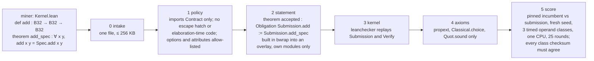

# FloatLib kernel competition

## Quick Summary

- A proof-gated speed competition on [FloatLib](https://github.com/lean-dojo/FloatLib)'s verified floating-point kernels. A miner submits one Lean file: a binary32 addition `Submission.add` and a proof that it equals `ExecFloat.Spec.add` on every pair of inputs, NaNs, infinities and signed zeros included. The gate checks the proof, re-checks it in the Lean kernel, audits axioms, then times the kernel against the incumbent. Lower time wins.
- The incumbent is FloatLib's own certified kernel, `ExecFloat.add`. The best proven kernel so far, `submissions/fastlog`, runs at **0.53x** of its time; an unproved textbook adder reaches **0.40x**.
- **Miners: read [`MANUAL.md`](MANUAL.md)** for setup, what to submit, how to measure, what to prove and what gets rejected. This README is the overview for operators and reviewers.
- One command sets up a fresh clone (about 15 minutes); one command tests the whole environment against 18 expected verdicts (about 4 minutes).

```bash
git clone <this repo> && cd conjectures-floatlib-competition
./setup.sh                                          # elan + Lean v4.34.0, FloatLib + Mathlib, build, .venv
export PATH=$HOME/.elan/bin:$PATH
.venv/bin/python selftest.py                        # 18/18 cases as expected = ready
.venv/bin/python gate.py submissions/fastlog        # intake, policy, statement, kernel, axioms, score
.venv/bin/python gate.py --bench my-kernel          # time an unproved kernel; never a verdict
```

## How the gate works



Every run writes `logs/gate-<utc>.log` (every command and its exit code) and one
`results/<submission>-<mode>-<utc>.json` verdict: the stage reached, the reason, the seed, the
ratio, per-class nanoseconds and spreads, and the sha256 of the pinned incumbent binary.

## The ladder

Same seed, 500k pairs per operand class, 25 rounds, one CPU:

| submission | what | verdict | time vs incumbent |
|---|---|---|---|
| `incumbent` | `ExecFloat.add`, proof `add_eq_spec` | accepted | 1.00x |
| `word` | `Configured.Backend.wordAdd` called directly | accepted | 1.00x: dispatch is free |
| `direct` | the word kernel `addFiniteImpl?` on raw bits, no carrier codec | accepted | 0.80x |
| `mirror` | `addFiniteImpl?` step for step on bare words, no `Option` or `Model` | accepted | 0.78x |
| `fastlog` | `mirror` with a binary-search `log2` in `roundProduct` | accepted | **0.53x** |
| `textbook-unproved` | guard/round/sticky adder, specials to `ExecFloat.add` | rejected at policy (`sorry`) | 0.40x with `--bench` |
| `wrong` | subtraction with the addition theorem | rejected at statement | |
| `cheat` | the host FPU with `native_decide` | rejected at policy | |

Where the incumbent's time goes: the carrier codec and the `Option`/`Model` wrappers around the
word kernel cost about 20%; `UInt64.log2`, which the runtime computes one bit at a time, about 30%.
None of the three accepted faster kernels needed new floating-point reasoning: each proves it
equals `wordAdd` and reuses `wordAdd_eq_spec`. Below 0.53x the cost is the algorithm itself, and
beating it means proving a new rounding argument, FloatLib's own being 563 lines.

## Security model

| threat | defence |
|---|---|
| a proof that does not prove the obligation | the gate's own `theorem accepted : Obligation Submission.add := Submission.add_spec` must typecheck |
| `sorry`, `native_decide`, custom axioms | `#print axioms accepted` must list only Lean's three |
| a forged compiled `.olean` whose proof never passed the kernel | `leanchecker` replays every declaration of `Submission` and `Verify` through the kernel |
| miner code running during the build (`#eval`, `run_cmd`, macros, `@[command_elab]`, `initialize`) | policy bans them, and every build and bench runs in bwrap: read-only root, no network |
| a build overwriting trusted files | builds write into a throwaway overlay; any file there not stemmed `Submission`, `Verify`, `Main` or `bench` rejects; FloatLib and Mathlib sit read-only under `.lake/packages` |
| slowing the incumbent (`csimp`, `@[export]`) | the incumbent is a separate binary built from `submissions/incumbent` and pinned, rebuilt only when its sources change |
| tuning for known operands | a fresh seed per run; three timed classes (near-one, wide-gap, cancellation) plus raw bit patterns checksummed |

`submissions/exploit-*` has one file per threat. All eight are rejected at policy, and the two
that matter most are also rejected by the later stages when policy is skipped: `exploit-forge` at
`kernel`, `exploit-tamper` at `statement`. `selftest.py` runs both checks.

## Timing

Incumbent and submission run as separate processes, alternating over 25 rounds, each round the
fastest of 3 in-process sweeps, pinned to one CPU with `taskset`. The incumbent against itself
reads 0.997 to 1.006x over four runs; with 9 rounds it swung to 0.956x, and unpinned it drifts by
about 3%. A 3% promotion bar needs the 25 rounds and the pinned CPU. Knobs: `BENCH_SEED`,
`BENCH_ROUNDS`, `BENCH_PAIRS`, `BENCH_CPU`, `GATE_SANDBOX`.

`lake build micro && lean/.lake/build/bin/micro` breaks one addition down on the same operands:

| operands | loop only | host FPU (unchecked) | certified word kernel | `ExecFloat.add` | textbook adder |
|---|---|---|---|---|---|
| random bit patterns | 5.2 ns | 17.0 ns | 27.2 ns | 27.2 ns | 18.9 ns |
| near one | 5.2 ns | 8.4 ns | 32.5 ns | 32.6 ns | 15.3 ns |

## Layout

| path | what |
|---|---|
| `lean/lakefile.lean` | the Lean workspace; FloatLib pinned at `0d91825` as a dependency, nothing in it edited |
| `lean/contract/Contract.lean` | `Binary32` and `Obligation`: the pinned statement |
| `lean/verify/Verify.lean` | the gate's three-line statement check and axiom report |
| `lean/bench/Bench.lean`, `Main.lean` | the shared timing core and the `bench` binary |
| `lean/bench/Micro.lean` | the cost breakdown above |
| `gate.py` | the stages, the sandbox, the lock, the logs and the JSON verdict; `--bench` for unproved kernels |
| `selftest.py`, `submissions/expected.tsv` | the environment test: every fixture against its expected verdict |
| `setup.sh` | one-command setup; `--check` reports only |
| `submissions/` | the ladder above, the unproved target and the exploit fixtures |
| `MANUAL.md` | the miner manual |

## Status

- Working: the gate, the timing, the self-test, the manual, and three proven faster kernels.
- To decide: the round rules (a submission service, rewards, the proposed 3% promotion bar, tie-breaking) in `MANUAL.md` section 12, and whether `fastlog` becomes the incumbent.
- Next slots follow the same shape, one obligation per operation and format: `Spec.mul`, `Spec.div`, `Spec.sqrt`, `Spec.fma`, and binary64.
