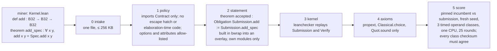

# FloatLib kernel competition

## Quick Summary

- A proof-gated speed competition on [FloatLib](https://github.com/lean-dojo/FloatLib)'s verified floating-point kernels. A miner submits one Lean file: a binary32 addition `Submission.add` and a proof that it equals `ExecFloat.Spec.add` on every pair of inputs, NaNs, infinities and signed zeros included. The gate checks the proof, re-checks it in the Lean kernel, audits axioms, then times the kernel against the incumbent. Lower time wins.
- The incumbent is FloatLib's own certified kernel, `ExecFloat.add`. The best proven kernel so far, `submissions/tuned`, runs at **0.50x** of its time (`fastlog` 0.53x); an unproved textbook adder reaches **0.40x**.
- **Miners: read [`MANUAL.md`](MANUAL.md)** for setup, what to submit, how to measure, what to prove and what gets rejected. This README is the overview for operators and reviewers.
- Three slots share one gate: binary32 `add` (the main one; best proven 0.50x), `mul` (best proven `mul-fast`, 0.55x) and `fma`, each with its own pinned obligation, incumbent and operand classes (`gate.py --slot mul|fma`). The validator service accepts all three; only the `add` board pays until the rewards split is decided.
- One command sets up a fresh clone (about 15 minutes); one command tests the whole environment against 26 expected verdicts across the three slots (about 9 minutes).
- A validator service is included: miners submit signed kernels over HTTP (`miner/submit.py`), a worker runs the gate, and a leaderboard ranks them.

```bash
git clone <this repo> && cd conjectures-floatlib-competition
./setup.sh                                          # elan + Lean v4.34.0, FloatLib + Mathlib, build, .venv
export PATH=$HOME/.elan/bin:$PATH
.venv/bin/python selftest.py                        # 26/26 cases as expected = ready
.venv/bin/python gate.py submissions/fastlog        # intake, policy, statement, kernel, axioms, score
.venv/bin/python gate.py --bench my-kernel          # time an unproved kernel; never a verdict
.venv/bin/python gate.py --slot mul submissions/mul-incumbent   # the multiplication slot
```

## How the gate works



Every run writes `logs/gate-<utc>.log` (every command and its exit code) and one
`results/<submission>-<mode>-<utc>.json` verdict: the stage reached, the reason, the seed, the
ratio, per-class nanoseconds and spreads, and the sha256 of the pinned incumbent binary.

## The ladder

Same seed, 500k pairs per operand class, 25 rounds, one CPU:

| submission | what | verdict | time vs incumbent |
|---|---|---|---|
| `incumbent` | `ExecFloat.add`, proof `add_eq_spec` | accepted | 1.00x |
| `word` | `Configured.Backend.wordAdd` called directly | accepted | 1.00x: dispatch is free |
| `direct` | the word kernel `addFiniteImpl?` on raw bits, no carrier codec | accepted | 0.80x |
| `mirror` | `addFiniteImpl?` step for step on bare words, no `Option` or `Model` | accepted | 0.78x |
| `fastlog` | `mirror` with a binary-search `log2` in `roundProduct` | accepted | 0.53x |
| `tuned` | `fastlog` with a one-compare special test and a rounding step on machine words | accepted | **0.50x** |
| `textbook-unproved` | guard/round/sticky adder, specials to `ExecFloat.add` | rejected at policy (`sorry`) | 0.40x with `--bench` |
| `wrong` | subtraction with the addition theorem | rejected at statement | |
| `cheat` | the host FPU with `native_decide` | rejected at policy | |

Where the incumbent's time goes: the carrier codec and the `Option`/`Model` wrappers around the
word kernel cost about 20%; `UInt64.log2`, which the runtime computes one bit at a time, about 30%.
None of the four accepted faster kernels needed new floating-point reasoning: each proves it
equals `wordAdd` and reuses `wordAdd_eq_spec`. Below 0.50x the cost is the algorithm itself, and
beating it means proving a new rounding argument, FloatLib's own being 563 lines.

## Security model

| threat | defence |
|---|---|
| a proof that does not prove the obligation | the gate's own `theorem accepted : Obligation Submission.add := Submission.add_spec` must typecheck |
| `sorry`, `native_decide`, custom axioms | `#print axioms accepted` must list only Lean's three |
| a forged compiled `.olean` whose proof never passed the kernel | `leanchecker` replays every declaration of `Submission` and `Verify` through the kernel |
| miner code running during the build (`#eval`, `run_cmd`, macros, `@[command_elab]`, `initialize`) | policy bans them, and every build and bench runs in bwrap: read-only root, no network |
| a build overwriting trusted files | builds write into a throwaway overlay; any file there not stemmed `Submission`, `Verify`, `Main` or `bench` rejects; FloatLib and Mathlib sit read-only under `.lake/packages` |
| slowing the incumbent (`csimp`, `@[export]`) | the incumbent is a separate binary built from `submissions/incumbent` and pinned, rebuilt only when its sources change |
| tuning for known operands | a fresh seed per run; three timed classes (near-one, wide-gap, cancellation) plus raw bit patterns checksummed |

`submissions/exploit-*` has one file per threat. All eight are rejected at policy, and the two
that matter most are also rejected by the later stages when policy is skipped: `exploit-forge` at
`kernel`, `exploit-tamper` at `statement`. `selftest.py` runs both checks.

## Timing

Incumbent and submission run as separate processes, alternating over 25 rounds, each round the
fastest of 3 in-process sweeps, pinned to one CPU with `taskset`. The incumbent against itself
reads 0.997 to 1.006x over four runs; with 9 rounds it swung to 0.956x, and unpinned it drifts by
about 3%. A 3% promotion bar needs the 25 rounds and the pinned CPU. Knobs: `BENCH_SEED`,
`BENCH_ROUNDS`, `BENCH_PAIRS`, `BENCH_CPU`, `GATE_SANDBOX`.

A one-hour study (`tools/timing_study.py`, 2026-09-24) alternated 86 full gate runs, each on a
fresh seed:

| submission | runs | mean | stdev | min | max | at or below 0.97 |
|---|---:|---:|---:|---:|---:|---:|
| `incumbent` against itself | 43 | 1.0005 | 0.0043 | 0.9932 | 1.0135 | 0 |
| `fastlog` | 43 | 0.5340 | 0.0044 | 0.5244 | 0.5563 | 43 |

No run of the incumbent against itself came near the 3% bar (closest 0.993, about 5 standard
deviations away), and `fastlog` cleared it every time. Single classes vary more than the total
(incumbent self-ratio per class 0.98 to 1.02), which is why the score sums all three.

`lake build micro && lean/.lake/build/bin/micro` breaks one addition down on the same operands:

| operands | loop only | host FPU (unchecked) | certified word kernel | `ExecFloat.add` | textbook adder |
|---|---|---|---|---|---|
| random bit patterns | 5.2 ns | 17.0 ns | 27.2 ns | 27.2 ns | 18.9 ns |
| near one | 5.2 ns | 8.4 ns | 32.5 ns | 32.6 ns | 15.3 ns |

## Running a validator

The gate runs on the host (it needs bubblewrap and the Lean toolchain); Postgres runs in
Docker; the API, the gate worker and the two chain workers run under pm2.

```bash
./setup.sh --chain                          # everything above, plus the service and the bittensor SDK
$EDITOR .env                                # POSTGRES_PASSWORD, the validator wallet, NETUID, BENCH_CPU
docker compose up -d db                     # Postgres 17 on POSTGRES_PORT (default 5433)
docker compose up migrate                   # alembic upgrade head
pm2 start pm2/service.config.js             # submission-api, gate-worker, chain-watcher, weight-setter
curl http://127.0.0.1:9300/health           # {"ok":true,"queued":0,"promotion_bar":0.97}
```

Each process runs from `validator/` (`cd validator && python -m service.api`); pm2 sets that directory itself.

| process | what it does |
|---|---|
| `submission-api` (`python -m service.api`) | `POST /submit` (optional `slot`: add, mul, fma), `GET /submissions/{id}`, `GET /leaderboard?slot=`, `GET /health`, `GET /ready` on `SERVICE_PORT` (9300) |
| `gate-worker` (`python -m service.worker`) | claims queued submissions oldest first, runs `gate.py <dir> --verdict`, stores the verdict; exit 2 or no verdict is a validator error, requeued uncharged |
| `chain-watcher` (`python -m workers.chain_watcher`) | streams subnet registrations into the store; without it nobody can submit |
| `weight-setter` (`python -m workers.weight_setter`) | once an epoch, pays the leaderboard's first qualifying hotkey (placeholder rule) and records the vector and its reasons; `WEIGHT_DRY_RUN=1` records without submitting |

**Promoting a winner** is an operator step: copy the winning `Kernel.lean` somewhere stable, set
`GATE_INCUMBENT` to it in `.env` (`GATE_INCUMBENT_MUL`, `GATE_INCUMBENT_FMA` for the other slots),
and restart the gate worker. The gate rebuilds that slot's pinned binary under `pinned/<slot>/`
on its next run, and the leaderboard moves to the new incumbent's ratios.

The service layer is ported from our DEFLATE competition (conjectures-miniz-oxide):
registrations and entitlement claims, the Postgres rate limiter, signed timestamps, the
queue with stale-claim recovery, and the weight-setting audit trail are unchanged. What is new is
the single-file submission, the ratio-based leaderboard filtered to the current incumbent, and
the king-of-the-hill placeholder scorer in `validator/scoring.py`.

```bash
# The service tests: a scratch database on the compose Postgres, a stub gate, one real-gate test.
set -a; . ./.env; set +a
.venv/bin/python -m pytest -q                  # 75 tests, about 2 minutes
.venv/bin/python -m pytest -q -m "not slow"    # 74 tests, seconds
```

## Layout

| path | what |
|---|---|
| `lean/lakefile.lean` | the Lean workspace; FloatLib pinned at `0d91825` as a dependency, nothing in it edited |
| `lean/contract/Contract.lean` | `Binary32` and `Obligation`: the pinned statement |
| `lean/verify/Verify.lean` | the gate's three-line statement check and axiom report |
| `lean/bench/Bench.lean`, `Main.lean` | the shared timing core and the `bench` binary |
| `lean/bench/Micro.lean` | the cost breakdown above |
| `gate.py` | the stages, the sandbox, the lock, the logs and the JSON verdict; `--bench` for unproved kernels |
| `selftest.py`, `submissions/expected.tsv` | the environment test: every fixture against its expected verdict |
| `setup.sh` | one-command setup; `--check` reports only |
| `submissions/` | the ladder above, the unproved target and the exploit fixtures |
| `validator/service/` | the submission API and the gate worker |
| `validator/db/` | the Postgres store: submissions, registrations, entitlement claims, rate limits, weight sets |
| `validator/chain/`, `validator/workers/` | the chain watcher and the weight setter (bittensor SDK) |
| `validator/scoring.py` | the king-of-the-hill placeholder scorer |
| `validator/tests/` | the service, security, entitlement, schema, chain and weight-setter tests |
| `deploy/`, `compose.yaml`, `pm2/` | Postgres, the Alembic migrations, the pm2 processes |
| `miner/submit.py` | the miner client: submit, status, leaderboard |
| `tools/evidence.py`, `evidence/EVIDENCE.md` | the generated evidence pack |
| `tools/timing_study.py` | the timing study behind the promotion bar |
| `MANUAL.md` | the miner manual |

## Status

- Working: the gate, the timing, the self-test, the manual, three proven faster kernels, and the validator service (API, gate worker, store, chain workers), tested live end to end.
- To decide: the rewards (the scorer is a king-of-the-hill placeholder), the proposed 3% promotion bar and tie-breaking in `MANUAL.md` section 12, the subnet (`NETUID`, default 66), and whether `fastlog` becomes the incumbent.
- Next slots follow the same shape, one obligation per operation and format: `Spec.mul`, `Spec.div`, `Spec.sqrt`, `Spec.fma`, and binary64.
