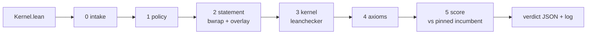

# Evidence - FloatLib kernel competition



## Quick Summary

- Generated 2026-09-24 13:06 UTC by `tools/evidence.py` from real gate runs on the machine in section 1; nothing here is typed by hand.
- **18/18** fixtures got exactly their expected verdict: 5 accepted, 13 rejected at the expected stage.
- Best accepted kernel this run: `fastlog` at **0.535x** of the incumbent's time.
- Sandbox containment: an `#eval` that writes `/tmp/pwned` ran during the build, and the file did **not** appear on the host.
- Timing: over 60 minutes, the incumbent against itself cleared the 0.97 bar 0 of 43 times, `fastlog` 43 of 43.

```bash
export PATH=$HOME/.elan/bin:$PATH
.venv/bin/python tools/evidence.py      # about 6 minutes; rewrites evidence/EVIDENCE.md and evidence.json
```

## 1. Environment

| | |
|---|---|
| CPU | AMD Ryzen 5 PRO 8540U w/ Radeon 740M Graphics, 12 threads |
| OS | Linux-7.0.0-34-generic-x86_64-with-glibc2.43 |
| Lean | Lean (version 4.34.0, x86_64-unknown-linux-gnu, commit 293d5d0c0c3f3dded4688b3ccd6a33939ac5102b, Release) |
| Lake | Lake version 5.0.0-src+293d5d0 (Lean version 4.34.0) |
| FloatLib | 0d91825727839f597fd06b22fdd038ea21480f0c |
| Mathlib | 5ed2965256430c3649e86755f9576b54eca72435 |
| bubblewrap | bubblewrap 0.11.1 |
| Python | 3.14.4 |
| pinned incumbent sha256 | 4c19abfac2ce0702220acba5f2e24c8f539be8f1af75ae34dae47473b3d15ac1 |

## 2. Setup from scratch

`./setup.sh` on a fresh clone (fetch FloatLib and Mathlib, Mathlib cache, build): **12m35.642s**.

## 3. Every fixture through the gate

Each row is one full `gate.py` pass. `nopolicy` skips the policy stage, to show the stages behind it hold on their own.

| submission | mode | expected | got | as expected | gate's reason, or time vs incumbent |
|---|---|---|---|---|---|
| `cheat` | gate | reject at policy | reject at policy | yes | import other than Contract: 'import FloatLib.Floats.Formats.BinaryInterchange.Configured.NativeFPU.Unchecked' |
| `direct` | gate | accept at score | accept at score | yes | 0.795x |
| `exploit-csimp` | gate | reject at policy | reject at policy | yes | banned name 'csimp' at line 14 |
| `exploit-eval` | gate | reject at policy | reject at policy | yes | banned name '#eval' at line 9 |
| `exploit-forge` | gate | reject at policy | reject at policy | yes | banned name 'run_cmd' at line 10 |
| `exploit-publicimport` | gate | reject at policy | reject at policy | yes | import other than Contract: 'public import Contract' |
| `exploit-skipkernel` | gate | reject at policy | reject at policy | yes | set_option debug.skipKernelTC is not allowed |
| `exploit-tactic` | gate | reject at policy | reject at policy | yes | attribute 'command_elab Lean.Parser.Command.check' is not allowed |
| `exploit-tamper` | gate | reject at policy | reject at policy | yes | banned name '#eval' at line 3 |
| `exploit-unsafeio` | gate | reject at policy | reject at policy | yes | banned name 'unsafe' at line 9 |
| `fastlog` | gate | accept at score | accept at score | yes | 0.535x |
| `incumbent` | gate | accept at score | accept at score | yes | 1.001x |
| `mirror` | gate | accept at score | accept at score | yes | 0.782x |
| `textbook-unproved` | gate | reject at policy | reject at policy | yes | banned name 'sorry' at line 63 |
| `word` | gate | accept at score | accept at score | yes | 1.000x |
| `wrong` | gate | reject at statement | reject at statement | yes | the obligation does not typecheck: error: work/Submission.lean:12:13: Type mismatch / error: build failed |
| `exploit-forge` | nopolicy | reject at kernel | reject at kernel | yes | leanchecker rejects Submission: leanchecker found a problem in Submission uncaught exception: while replayi... |
| `exploit-tamper` | nopolicy | reject at statement | reject at statement | yes | the build wrote outside the submission's modules: ['lib/lean/Contract.olean.hash'] |

## 4. Accepted kernels: timing per operand class

Nanoseconds per addition, fastest of 25 rounds, 500,000 pairs per class, fresh seed per run.

| submission | seed | class | incumbent ns | submission ns | ratio |
|---|---:|---|---:|---:|---:|
| `direct` | 2361336857 | near-one | 51.61 | 42.87 | 0.831 |
| `direct` | 2361336857 | wide-gap | 57.94 | 43.28 | 0.747 |
| `direct` | 2361336857 | cancel | 40.60 | 33.27 | 0.819 |
| `fastlog` | 4005073712 | near-one | 51.64 | 31.34 | 0.607 |
| `fastlog` | 4005073712 | wide-gap | 57.45 | 25.32 | 0.441 |
| `fastlog` | 4005073712 | cancel | 40.41 | 23.27 | 0.576 |
| `incumbent` | 223362324 | near-one | 51.54 | 51.66 | 1.002 |
| `incumbent` | 223362324 | wide-gap | 57.99 | 58.12 | 1.002 |
| `incumbent` | 223362324 | cancel | 40.64 | 40.61 | 0.999 |
| `mirror` | 2149684287 | near-one | 51.76 | 41.96 | 0.811 |
| `mirror` | 2149684287 | wide-gap | 57.17 | 41.60 | 0.728 |
| `mirror` | 2149684287 | cancel | 40.61 | 33.38 | 0.822 |
| `word` | 2809637394 | near-one | 51.54 | 51.33 | 0.996 |
| `word` | 2809637394 | wide-gap | 57.60 | 57.73 | 1.002 |
| `word` | 2809637394 | cancel | 40.66 | 40.71 | 1.001 |

## 5. Sandbox containment

`submissions/exploit-eval` contains `#eval show IO Unit from IO.FS.writeFile "/tmp/pwned" "x"`. With the
policy stage skipped, that code really runs while the gate builds the file. The build runs in
bwrap with a private `/tmp`, no network and a read-only root, so the write lands in the sandbox
and disappears with it.

| | |
|---|---|
| `/tmp/pwned` on the host before | absent |
| `/tmp/pwned` on the host after | absent: contained |
| gate verdict | accept at score  |

The kernel itself is FloatLib's, so with policy off it is accepted; in real runs policy rejects it
first (section 3, `exploit-eval`, gate mode).

## 6. Timing stability

`tools/timing_study.py`, 60 minutes of alternating full gate runs, fresh seed each:

| submission | runs | mean | stdev | min | max | at or below 0.97 |
|---|---:|---:|---:|---:|---:|---:|
| `incumbent` | 43 | 1.0005 | 0.0043 | 0.9932 | 1.0135 | 0 |
| `fastlog` | 43 | 0.5340 | 0.0044 | 0.5244 | 0.5563 | 43 |

## 7. What this does not show

- Other hardware: everything above ran on the machine in section 1. The validator's server needs its own timing study before launch.
- Kernels within about 1.5% of each other cannot be ranked by timing; ties need the earlier-submission rule.
- Attacks beyond the eight fixtures: the policy is a text scan backed by the sandbox, leanchecker and the axiom audit, not a proof of completeness.
