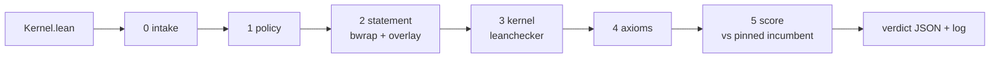

# Evidence - FloatLib kernel competition



## Quick Summary

- Generated 2026-10-06 11:06 UTC by `tools/evidence.py` from real gate runs on the machine in section 1; nothing here is typed by hand.
- **28/28** fixtures across the `add`, `mul`, `fma` slots got exactly their expected verdict: 11 accepted, 17 rejected at the expected stage.
- Best accepted kernel per slot this run: `add/tuned` at **0.519x**, `mul/fast` at **0.554x**, `fma/incumbent` at **0.998x**, each of its own slot's incumbent's time.
- Sandbox containment: an `#eval` that writes `/tmp/pwned` ran during the build, and the file did **not** appear on the host.
- Timing (`add`, study of 2026-09-24 13:06 UTC): over 60 minutes, the incumbent against itself cleared the 0.97 bar 0 of 43 times, `fastlog` 43 of 43.

```bash
export PATH=$HOME/.elan/bin:$PATH
.venv/bin/python tools/evidence.py      # about 10 minutes; rewrites evidence/EVIDENCE.md and evidence.json
```

## 1. Environment

| | |
|---|---|
| CPU | AMD Ryzen 5 PRO 8540U w/ Radeon 740M Graphics, 12 threads |
| OS | Linux-7.0.0-34-generic-x86_64-with-glibc2.43 |
| Lean | Lean (version 4.34.0, x86_64-unknown-linux-gnu, commit 293d5d0c0c3f3dded4688b3ccd6a33939ac5102b, Release) |
| Lake | Lake version 5.0.0-src+293d5d0 (Lean version 4.34.0) |
| FloatLib | 0d91825727839f597fd06b22fdd038ea21480f0c |
| Mathlib | 5ed2965256430c3649e86755f9576b54eca72435 |
| bubblewrap | bubblewrap 0.11.1 |
| Python | 3.12.14 |
| pinned `add` incumbent sha256 | 38ce67f0591b27190e19c91e00f3655d080c04ec5077b970afb07097343a4302 |
| pinned `fma` incumbent sha256 | 6848107e686ce7148176938a78db7ad5c4a571398cff8408553a0a6788406065 |
| pinned `mul` incumbent sha256 | bc1899244f02a90f7f9c2c26a547c6e2acfa39f192336b673653ee1c9481d160 |

## 2. Setup from scratch

`./setup.sh` on a fresh clone (fetch FloatLib and Mathlib, Mathlib cache, build): **12m35.642s (measured 2026-09-24 13:06 UTC)**.

## 3. Every fixture through the gate

Each row is one full `gate.py` pass. `nopolicy` skips the policy stage, to show the stages behind it hold on their own.

| submission | slot | mode | expected | got | as expected | gate's reason, or time vs incumbent |
|---|---|---|---|---|---|---|
| `add/cheat` | add | gate | reject at policy | reject at policy | yes | import other than Contract: 'import FloatLib.Floats.Formats.BinaryInterchange.Configured.NativeFPU.Unchecked' |
| `add/direct` | add | gate | accept at score | accept at score | yes | 0.794x |
| `exploits/csimp` | add | gate | reject at policy | reject at policy | yes | banned name 'csimp' at line 14 |
| `exploits/eval` | add | gate | reject at policy | reject at policy | yes | banned name '#eval' at line 9 |
| `exploits/includestr` | add | gate | reject at policy | reject at policy | yes | banned name 'include_str' at line 4 |
| `exploits/membomb` | add | gate | reject at score | reject at score | yes | bench killed: over the 512 MB bench memory cap |
| `exploits/forge` | add | gate | reject at policy | reject at policy | yes | banned name 'run_cmd' at line 10 |
| `exploits/publicimport` | add | gate | reject at policy | reject at policy | yes | import other than Contract: 'public import Contract' |
| `exploits/skipkernel` | add | gate | reject at policy | reject at policy | yes | set_option debug.skipKernelTC is not allowed |
| `exploits/tactic` | add | gate | reject at policy | reject at policy | yes | attribute 'command_elab Lean.Parser.Command.check' is not allowed |
| `exploits/tamper` | add | gate | reject at policy | reject at policy | yes | banned name '#eval' at line 3 |
| `exploits/unsafeio` | add | gate | reject at policy | reject at policy | yes | banned name 'unsafe' at line 9 |
| `add/fastlog` | add | gate | accept at score | accept at score | yes | 0.548x |
| `add/incumbent` | add | gate | accept at score | accept at score | yes | 0.997x |
| `add/mirror` | add | gate | accept at score | accept at score | yes | 0.792x |
| `add/textbook-unproved` | add | gate | reject at policy | reject at policy | yes | banned name 'sorry' at line 63 |
| `add/tuned` | add | gate | accept at score | accept at score | yes | 0.519x |
| `add/word` | add | gate | accept at score | accept at score | yes | 0.997x |
| `add/wrong` | add | gate | reject at statement | reject at statement | yes | the obligation does not typecheck: error: work/Submission.lean:12:13: Type mismatch / error: build failed |
| `exploits/forge` | add | nopolicy | reject at kernel | reject at kernel | yes | leanchecker rejects Submission: leanchecker found a problem in Submission uncaught exception: while replayi... |
| `exploits/tamper` | add | nopolicy | reject at statement | reject at statement | yes | the build wrote outside the submission's modules: ['lib/lean/Contract.olean.hash'] |
| `mul/incumbent` | mul | gate | accept at score | accept at score | yes | 1.006x |
| `mul/fast` | mul | gate | accept at score | accept at score | yes | 0.554x |
| `mul/word` | mul | gate | accept at score | accept at score | yes | 1.001x |
| `mul/wrong` | mul | gate | reject at statement | reject at statement | yes | the obligation does not typecheck: error: work/Submission.lean:12:13: Type mismatch / error: build failed |
| `fma/incumbent` | fma | gate | accept at score | accept at score | yes | 0.998x |
| `fma/word` | fma | gate | accept at score | accept at score | yes | 1.005x |
| `fma/wrong` | fma | gate | reject at statement | reject at statement | yes | the obligation does not typecheck: error: work/Submission.lean:15:15: Type mismatch / error: build failed |

## 4. Accepted kernels: timing per operand class

Nanoseconds per operation, fastest of 25 rounds, 500,000 operand sets per class, fresh seed per run; each ratio is against that slot's incumbent.

| submission | slot | seed | class | incumbent ns | submission ns | ratio |
|---|---|---:|---|---:|---:|---:|
| `add/direct` | add | 3919913191 | near-one | 51.48 | 42.59 | 0.827 |
| `add/direct` | add | 3919913191 | wide-gap | 57.86 | 42.94 | 0.742 |
| `add/direct` | add | 3919913191 | cancel | 40.14 | 33.20 | 0.827 |
| `add/fastlog` | add | 2281147088 | near-one | 50.88 | 32.26 | 0.634 |
| `add/fastlog` | add | 2281147088 | wide-gap | 56.75 | 25.06 | 0.442 |
| `add/fastlog` | add | 2281147088 | cancel | 40.34 | 23.70 | 0.588 |
| `add/incumbent` | add | 2969270009 | near-one | 51.09 | 51.10 | 1.000 |
| `add/incumbent` | add | 2969270009 | wide-gap | 57.42 | 57.23 | 0.997 |
| `add/incumbent` | add | 2969270009 | cancel | 40.43 | 40.21 | 0.994 |
| `add/mirror` | add | 2626753138 | near-one | 51.13 | 42.21 | 0.826 |
| `add/mirror` | add | 2626753138 | wide-gap | 57.09 | 42.44 | 0.744 |
| `add/mirror` | add | 2626753138 | cancel | 40.02 | 32.73 | 0.818 |
| `add/tuned` | add | 3256631095 | near-one | 51.39 | 32.28 | 0.628 |
| `add/tuned` | add | 3256631095 | wide-gap | 58.12 | 23.66 | 0.407 |
| `add/tuned` | add | 3256631095 | cancel | 40.27 | 21.77 | 0.541 |
| `add/word` | add | 956333327 | near-one | 50.78 | 50.94 | 1.003 |
| `add/word` | add | 956333327 | wide-gap | 56.99 | 56.81 | 0.997 |
| `add/word` | add | 956333327 | cancel | 40.15 | 39.72 | 0.989 |
| `mul/incumbent` | mul | 2893014785 | near-one | 33.95 | 34.49 | 1.016 |
| `mul/incumbent` | mul | 2893014785 | spread | 36.05 | 36.14 | 1.003 |
| `mul/incumbent` | mul | 2893014785 | tiny | 32.97 | 32.96 | 1.000 |
| `mul/fast` | mul | 808248716 | near-one | 33.77 | 18.35 | 0.544 |
| `mul/fast` | mul | 808248716 | spread | 36.03 | 20.46 | 0.568 |
| `mul/fast` | mul | 808248716 | tiny | 33.00 | 18.10 | 0.548 |
| `mul/word` | mul | 189129590 | near-one | 33.91 | 34.17 | 1.008 |
| `mul/word` | mul | 189129590 | spread | 36.14 | 36.28 | 1.004 |
| `mul/word` | mul | 189129590 | tiny | 33.38 | 33.08 | 0.991 |
| `fma/incumbent` | fma | 1586195337 | near-one | 65.90 | 65.66 | 0.996 |
| `fma/incumbent` | fma | 1586195337 | cancel | 62.20 | 61.99 | 0.997 |
| `fma/incumbent` | fma | 1586195337 | wide | 245.13 | 244.83 | 0.999 |
| `fma/word` | fma | 1872685546 | near-one | 66.22 | 65.96 | 0.996 |
| `fma/word` | fma | 1872685546 | cancel | 62.43 | 62.24 | 0.997 |
| `fma/word` | fma | 1872685546 | wide | 244.37 | 246.61 | 1.009 |

## 5. Sandbox containment

`kernels/exploits/eval` contains `#eval show IO Unit from IO.FS.writeFile "/tmp/pwned" "x"`. With the
policy stage skipped, that code really runs while the gate builds the file. The build runs in
bwrap with a private `/tmp`, no network and a read-only root, so the write lands in the sandbox
and disappears with it.

| | |
|---|---|
| `/tmp/pwned` on the host before | absent |
| `/tmp/pwned` on the host after | absent: contained |
| gate verdict | accept at score  |

The kernel itself is FloatLib's, so with policy off it is accepted; in real runs policy rejects it
first (section 3, `exploits/eval`, gate mode).

## 6. Timing stability

`tools/timing_study.py` on `add`, measured 2026-09-24 13:06 UTC: 60 minutes of alternating full gate runs, fresh seed each:

| submission | runs | mean | stdev | min | max | at or below 0.97 |
|---|---:|---:|---:|---:|---:|---:|
| `incumbent` | 43 | 1.0005 | 0.0043 | 0.9932 | 1.0135 | 0 |
| `fastlog` | 43 | 0.5340 | 0.0044 | 0.5244 | 0.5563 | 43 |

## 7. What this does not show

- Other hardware: everything above ran on the machine in section 1. The validator's server needs its own timing study before launch.
- Kernels within about 1.5% of each other cannot be ranked by timing; ties need the earlier-submission rule.
- Attacks beyond the 10 exploit fixtures: the policy is a text scan backed by the sandbox, leanchecker and the axiom audit, not a proof of completeness.
