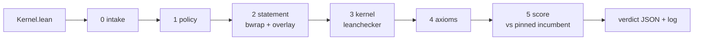

# Evidence - TorchLean kernel competition (on FloatLib)



## Quick Summary

- Generated 2026-10-09 08:54 UTC by `validator/tools/evidence.py` from real gate runs on the machine in section 1; nothing here is typed by hand.
- **48/48** fixtures across the `add`, `mul`, `fma`, `div`, `sqrt`, `sum`, `bmm`, `full` slots got exactly their expected verdict: 21 accepted, 27 rejected at the expected stage.
- Best accepted kernel per slot this run: `add/tuned` at **0.532x**, `mul/fast` at **0.556x**, `fma/incumbent` at **0.996x**, `div/incumbent` at **0.997x**, `sqrt/word` at **1.000x**, `sum/tuned` at **0.527x**, `bmm/fast` at **0.567x**, `full/incumbent` at **1.005x**, each of its own slot's incumbent's time.
- Sandbox containment: an `#eval` that writes `/tmp/pwned` ran during the build, and the file did **not** appear on the host.
- Timing (`full`, study of 2026-10-08 13:34 UTC): over 62 minutes, the incumbent against itself cleared the 0.97 bar 0 of 11 times, `baseline` 0 of 11.

```bash
export PATH=$HOME/.elan/bin:$PATH
.venv/bin/python validator/tools/evidence.py   # about 35 minutes; rewrites evidence/EVIDENCE.md and evidence.json
```

## 1. Environment

| | |
|---|---|
| CPU | AMD Ryzen 5 PRO 8540U w/ Radeon 740M Graphics, 12 threads |
| OS | Linux-7.0.0-38-generic-x86_64-with-glibc2.43 |
| Lean | Lean (version 4.34.0, x86_64-unknown-linux-gnu, commit 293d5d0c0c3f3dded4688b3ccd6a33939ac5102b, Release) |
| Lake | Lake version 5.0.0-src+293d5d0 (Lean version 4.34.0) |
| FloatLib | 0d91825727839f597fd06b22fdd038ea21480f0c |
| Mathlib | 5ed2965256430c3649e86755f9576b54eca72435 |
| bubblewrap | bubblewrap 0.11.1 |
| Python | 3.12.14 |
| pinned `add` incumbent sha256 | 38ce67f0591b27190e19c91e00f3655d080c04ec5077b970afb07097343a4302 |
| pinned `bmm` incumbent sha256 | 4ff962dd092497f51f29f0c2931f05802bc393522ab0813db7734a0183483b05 |
| pinned `div` incumbent sha256 | fda0939021fbfdb5225cea7d3905013e245cdd5be38fa57396c907fc3add83ea |
| pinned `fma` incumbent sha256 | 6848107e686ce7148176938a78db7ad5c4a571398cff8408553a0a6788406065 |
| pinned `full` incumbent sha256 | e0273a66e27fc6492258a8867675330a6b47fe9b06c1939af732fe8bf2ffa59a |
| pinned `mul` incumbent sha256 | bc1899244f02a90f7f9c2c26a547c6e2acfa39f192336b673653ee1c9481d160 |
| pinned `sqrt` incumbent sha256 | 75b5be4832fc1009510487f116b0d5e04e633eeb34b818292d3ff1df66744712 |
| pinned `sum` incumbent sha256 | 768b3175c9d66fe2df597deebf55524f3a39b3c49f022150404971059b009bb5 |

## 2. Setup from scratch

`./setup.sh` on a fresh clone (fetch FloatLib and Mathlib, Mathlib cache, build): **12m35.642s (measured 2026-09-24 13:06 UTC)**.

## 3. Every fixture through the gate

Each row is one full `gate.py` pass. `nopolicy` skips the policy stage, to show the stages behind it hold on their own.

| submission | slot | mode | expected | got | as expected | gate's reason, or time vs incumbent |
|---|---|---|---|---|---|---|
| `add/cheat` | add | gate | reject at policy | reject at policy | yes | import other than Contract: 'import FloatLib.Floats.Formats.BinaryInterchange.Configured.NativeFPU.Unchecked' |
| `add/direct` | add | gate | accept at score | accept at score | yes | 0.786x |
| `exploits/csimp` | add | gate | reject at policy | reject at policy | yes | banned name 'csimp' at line 14 |
| `exploits/eval` | add | gate | reject at policy | reject at policy | yes | banned name '#eval' at line 9 |
| `exploits/includestr` | add | gate | reject at policy | reject at policy | yes | banned name 'include_str' at line 4 |
| `exploits/membomb` | add | gate | reject at score | reject at score | yes | bench killed: over the 512 MB bench memory cap |
| `exploits/forge` | add | gate | reject at policy | reject at policy | yes | banned name 'run_cmd' at line 10 |
| `exploits/publicimport` | add | gate | reject at policy | reject at policy | yes | import other than Contract: 'public import Contract' |
| `exploits/skipkernel` | add | gate | reject at policy | reject at policy | yes | set_option debug.skipKernelTC is not allowed |
| `exploits/tactic` | add | gate | reject at policy | reject at policy | yes | banned name 'command_elab' at line 9 |
| `exploits/tamper` | add | gate | reject at policy | reject at policy | yes | banned name '#eval' at line 3 |
| `exploits/unsafeio` | add | gate | reject at policy | reject at policy | yes | banned name 'unsafe' at line 9 |
| `exploits/simproc` | add | gate | reject at policy | reject at policy | yes | banned name 'simproc' at line 12 |
| `exploits/runtac` | add | gate | reject at policy | reject at policy | yes | banned name 'run_tac' at line 12 |
| `exploits/heartbeats` | add | gate | reject at policy | reject at policy | yes | set_option maxHeartbeats 0: allowed values are 1 to 4000000 |
| `exploits/hiddenoption` | add | gate | reject at policy | reject at policy | yes | set_option debug.skipKernelTC is not allowed |
| `exploits/sorryax` | add | gate | reject at axioms | reject at axioms | yes | extra axioms ['sorryAx'] |
| `add/fastlog` | add | gate | accept at score | accept at score | yes | 0.548x |
| `add/incumbent` | add | gate | accept at score | accept at score | yes | 1.004x |
| `add/mirror` | add | gate | accept at score | accept at score | yes | 0.807x |
| `add/textbook-unproved` | add | gate | reject at policy | reject at policy | yes | banned name 'sorry' at line 63 |
| `add/tuned` | add | gate | accept at score | accept at score | yes | 0.532x |
| `add/word` | add | gate | accept at score | accept at score | yes | 1.002x |
| `add/wrong` | add | gate | reject at statement | reject at statement | yes | the obligation does not typecheck: error: work/Submission.lean:12:13: Type mismatch / error: build failed |
| `exploits/forge` | add | nopolicy | reject at kernel | reject at kernel | yes | leanchecker rejects Submission: leanchecker found a problem in Submission uncaught exception: while replayi... |
| `exploits/tamper` | add | nopolicy | reject at statement | reject at statement | yes | the build wrote outside the submission's modules: ['lib/lean/Contract.olean.hash'] |
| `mul/incumbent` | mul | gate | accept at score | accept at score | yes | 1.001x |
| `mul/fast` | mul | gate | accept at score | accept at score | yes | 0.556x |
| `mul/word` | mul | gate | accept at score | accept at score | yes | 0.995x |
| `mul/wrong` | mul | gate | reject at statement | reject at statement | yes | the obligation does not typecheck: error: work/Submission.lean:12:13: Type mismatch / error: build failed |
| `fma/incumbent` | fma | gate | accept at score | accept at score | yes | 0.996x |
| `fma/word` | fma | gate | accept at score | accept at score | yes | 1.004x |
| `fma/wrong` | fma | gate | reject at statement | reject at statement | yes | the obligation does not typecheck: error: work/Submission.lean:15:15: Type mismatch / error: build failed |
| `div/incumbent` | div | gate | accept at score | accept at score | yes | 0.997x |
| `div/word` | div | gate | accept at score | accept at score | yes | 1.009x |
| `div/wrong` | div | gate | reject at statement | reject at statement | yes | the obligation does not typecheck: error: work/Submission.lean:12:13: Type mismatch / error: build failed |
| `sqrt/incumbent` | sqrt | gate | accept at score | accept at score | yes | 1.004x |
| `sqrt/word` | sqrt | gate | accept at score | accept at score | yes | 1.000x |
| `sqrt/wrong` | sqrt | gate | reject at statement | reject at statement | yes | the obligation does not typecheck: error: work/Submission.lean:12:11: Type mismatch / error: build failed |
| `sum/incumbent` | sum | gate | accept at score | accept at score | yes | 0.998x |
| `sum/tuned` | sum | gate | accept at score | accept at score | yes | 0.527x |
| `sum/wrong` | sum | gate | reject at statement | reject at statement | yes | the obligation does not typecheck: error: work/Submission.lean:18:6: Tactic `rewrite` failed: Did not find ... |
| `bmm/incumbent` | bmm | gate | accept at score | accept at score | yes | 1.002x |
| `bmm/fast` | bmm | gate | accept at score | accept at score | yes | 0.567x |
| `bmm/wrong` | bmm | gate | reject at statement | reject at statement | yes | the obligation does not typecheck: error: work/Submission.lean:34:2: Tactic `simp` failed with a nested err... |
| `full/incumbent` | full | gate | accept at score | accept at score | yes | 1.005x |
| `full/baseline` | full | gate | accept at score | accept at score | yes | 1.776x |
| `full/wrong` | full | gate | reject at statement | reject at statement | yes | the obligation does not typecheck: error: work/Submission.lean:39:6: Tactic `rewrite` failed: Did not find ... |

## 4. Accepted kernels: timing per operand class

Nanoseconds per operation, fastest of 25 rounds, 500,000 operand sets per class, fresh seed per run; each ratio is against that slot's incumbent.

| submission | slot | seed | class | incumbent ns | submission ns | ratio |
|---|---|---:|---|---:|---:|---:|
| `add/direct` | add | 50985136 | near-one | 53.92 | 44.27 | 0.821 |
| `add/direct` | add | 50985136 | wide-gap | 60.98 | 44.86 | 0.736 |
| `add/direct` | add | 50985136 | cancel | 42.35 | 34.45 | 0.814 |
| `add/fastlog` | add | 2287868891 | near-one | 56.08 | 34.27 | 0.611 |
| `add/fastlog` | add | 2287868891 | wide-gap | 59.83 | 26.77 | 0.447 |
| `add/fastlog` | add | 2287868891 | cancel | 41.89 | 25.51 | 0.609 |
| `add/incumbent` | add | 3041882031 | near-one | 52.70 | 54.10 | 1.027 |
| `add/incumbent` | add | 3041882031 | wide-gap | 60.18 | 60.59 | 1.007 |
| `add/incumbent` | add | 3041882031 | cancel | 42.90 | 41.75 | 0.973 |
| `add/mirror` | add | 1346276433 | near-one | 53.90 | 45.07 | 0.836 |
| `add/mirror` | add | 1346276433 | wide-gap | 61.37 | 45.62 | 0.743 |
| `add/mirror` | add | 1346276433 | cancel | 40.95 | 35.34 | 0.863 |
| `add/tuned` | add | 2048804661 | near-one | 54.71 | 34.05 | 0.622 |
| `add/tuned` | add | 2048804661 | wide-gap | 60.52 | 25.52 | 0.422 |
| `add/tuned` | add | 2048804661 | cancel | 41.13 | 23.56 | 0.573 |
| `add/word` | add | 2112344859 | near-one | 53.52 | 53.42 | 0.998 |
| `add/word` | add | 2112344859 | wide-gap | 60.12 | 59.99 | 0.998 |
| `add/word` | add | 2112344859 | cancel | 41.16 | 41.73 | 1.014 |
| `mul/incumbent` | mul | 1862235207 | near-one | 35.75 | 35.84 | 1.003 |
| `mul/incumbent` | mul | 1862235207 | spread | 37.45 | 37.58 | 1.004 |
| `mul/incumbent` | mul | 1862235207 | tiny | 35.18 | 35.05 | 0.996 |
| `mul/fast` | mul | 2623179690 | near-one | 35.70 | 19.12 | 0.536 |
| `mul/fast` | mul | 2623179690 | spread | 37.19 | 21.61 | 0.581 |
| `mul/fast` | mul | 2623179690 | tiny | 34.03 | 18.70 | 0.550 |
| `mul/word` | mul | 2205922741 | near-one | 35.74 | 35.03 | 0.980 |
| `mul/word` | mul | 2205922741 | spread | 37.15 | 37.84 | 1.019 |
| `mul/word` | mul | 2205922741 | tiny | 35.24 | 34.74 | 0.986 |
| `fma/incumbent` | fma | 3657630599 | near-one | 69.41 | 68.97 | 0.994 |
| `fma/incumbent` | fma | 3657630599 | cancel | 64.48 | 65.81 | 1.021 |
| `fma/incumbent` | fma | 3657630599 | wide | 262.95 | 260.47 | 0.991 |
| `fma/word` | fma | 2828518775 | near-one | 68.53 | 68.85 | 1.005 |
| `fma/word` | fma | 2828518775 | cancel | 65.65 | 65.18 | 0.993 |
| `fma/word` | fma | 2828518775 | wide | 260.91 | 262.58 | 1.006 |
| `div/incumbent` | div | 1415890166 | near-one | 51.43 | 51.95 | 1.010 |
| `div/incumbent` | div | 1415890166 | spread | 53.07 | 52.47 | 0.989 |
| `div/incumbent` | div | 1415890166 | extremes | 54.76 | 54.28 | 0.991 |
| `div/word` | div | 2677726773 | near-one | 51.24 | 51.76 | 1.010 |
| `div/word` | div | 2677726773 | spread | 52.76 | 53.06 | 1.006 |
| `div/word` | div | 2677726773 | extremes | 54.02 | 54.60 | 1.011 |
| `sqrt/incumbent` | sqrt | 395708523 | near-one | 47.60 | 47.11 | 0.990 |
| `sqrt/incumbent` | sqrt | 395708523 | spread | 47.25 | 47.68 | 1.009 |
| `sqrt/incumbent` | sqrt | 395708523 | subnormal | 47.24 | 47.89 | 1.014 |
| `sqrt/word` | sqrt | 3582571020 | near-one | 48.19 | 48.04 | 0.997 |
| `sqrt/word` | sqrt | 3582571020 | spread | 48.45 | 48.49 | 1.001 |
| `sqrt/word` | sqrt | 3582571020 | subnormal | 48.44 | 48.59 | 1.003 |
| `sum/incumbent` | sum | 3383002100 | dense | 46.75 | 46.99 | 1.005 |
| `sum/incumbent` | sum | 3383002100 | relu | 43.56 | 43.38 | 0.996 |
| `sum/incumbent` | sum | 3383002100 | wide | 45.33 | 44.96 | 0.992 |
| `sum/tuned` | sum | 2809044874 | dense | 46.48 | 21.97 | 0.473 |
| `sum/tuned` | sum | 2809044874 | relu | 44.16 | 31.68 | 0.717 |
| `sum/tuned` | sum | 2809044874 | wide | 45.30 | 18.01 | 0.398 |
| `bmm/incumbent` | bmm | 3300536711 | dense | 86.63 | 86.36 | 0.997 |
| `bmm/incumbent` | bmm | 3300536711 | relu | 71.24 | 71.92 | 1.010 |
| `bmm/incumbent` | bmm | 3300536711 | wide | 72.62 | 72.70 | 1.001 |
| `bmm/fast` | bmm | 2198504985 | dense | 86.57 | 45.02 | 0.520 |
| `bmm/fast` | bmm | 2198504985 | relu | 72.09 | 49.10 | 0.681 |
| `bmm/fast` | bmm | 2198504985 | wide | 73.27 | 37.36 | 0.510 |
| `full/incumbent` | full | 3817500512 | add:near-one | 31.33 | 31.81 | 1.015 |
| `full/incumbent` | full | 3817500512 | add:wide-gap | 24.51 | 24.47 | 0.999 |
| `full/incumbent` | full | 3817500512 | add:cancel | 22.81 | 23.04 | 1.010 |
| `full/incumbent` | full | 3817500512 | mul:near-one | 19.02 | 18.76 | 0.986 |
| `full/incumbent` | full | 3817500512 | mul:spread | 21.26 | 21.12 | 0.994 |
| `full/incumbent` | full | 3817500512 | mul:tiny | 18.97 | 19.01 | 1.002 |
| `full/incumbent` | full | 3817500512 | sum:dense | 21.20 | 21.41 | 1.010 |
| `full/incumbent` | full | 3817500512 | sum:relu | 31.10 | 31.19 | 1.003 |
| `full/incumbent` | full | 3817500512 | sum:wide | 17.91 | 17.96 | 1.003 |
| `full/incumbent` | full | 3817500512 | bmm:dense | 43.08 | 43.91 | 1.019 |
| `full/incumbent` | full | 3817500512 | bmm:relu | 48.79 | 48.32 | 0.990 |
| `full/incumbent` | full | 3817500512 | bmm:wide | 36.89 | 37.55 | 1.018 |
| `full/baseline` | full | 1793095140 | add:near-one | 31.24 | 44.77 | 1.433 |
| `full/baseline` | full | 1793095140 | add:wide-gap | 24.66 | 45.34 | 1.839 |
| `full/baseline` | full | 1793095140 | add:cancel | 22.89 | 35.71 | 1.560 |
| `full/baseline` | full | 1793095140 | mul:near-one | 18.95 | 45.05 | 2.377 |
| `full/baseline` | full | 1793095140 | mul:spread | 21.40 | 47.34 | 2.212 |
| `full/baseline` | full | 1793095140 | mul:tiny | 18.82 | 44.90 | 2.385 |
| `full/baseline` | full | 1793095140 | sum:dense | 20.81 | 37.48 | 1.801 |
| `full/baseline` | full | 1793095140 | sum:relu | 30.70 | 39.08 | 1.273 |
| `full/baseline` | full | 1793095140 | sum:wide | 18.03 | 33.86 | 1.878 |
| `full/baseline` | full | 1793095140 | bmm:dense | 43.53 | 81.23 | 1.866 |
| `full/baseline` | full | 1793095140 | bmm:relu | 47.49 | 69.59 | 1.466 |
| `full/baseline` | full | 1793095140 | bmm:wide | 36.47 | 70.61 | 1.936 |

## 5. Sandbox containment

`kernels/exploits/eval` contains `#eval show IO Unit from IO.FS.writeFile "/tmp/pwned" "x"`. With the
policy stage skipped, that code really runs while the gate builds the file. The build runs in
bwrap with a private `/tmp`, no network and a read-only root, so the write lands in the sandbox
and disappears with it.

| | |
|---|---|
| `/tmp/pwned` on the host before | absent |
| `/tmp/pwned` on the host after | absent: contained |
| gate verdict | accept at score  |

The kernel itself is FloatLib's, so with policy off it is accepted; in real runs policy rejects it
first (section 3, `exploits/eval`, gate mode).

## 6. Timing stability

`validator/tools/timing_study.py` on `full`, measured 2026-10-08 13:34 UTC: 62 minutes of alternating full gate runs, fresh seed each:

| submission | runs | mean | stdev | min | max | at or below 0.97 |
|---|---:|---:|---:|---:|---:|---:|
| `incumbent` | 11 | 1.0007 | 0.0013 | 0.9977 | 1.0020 | 0 |
| `baseline` | 11 | 1.7947 | 0.0039 | 1.7880 | 1.7992 | 0 |

## 7. What this does not show

- Other hardware: everything above ran on the machine in section 1. The validator's server needs its own timing study before launch.
- Kernels within about 1.5% of each other cannot be ranked by timing; ties need the earlier-submission rule.
- Attacks beyond the 15 exploit fixtures: the policy is a text scan backed by the sandbox, leanchecker and the axiom audit, not a proof of completeness.
