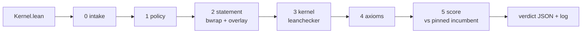

# Evidence - TorchLean kernel competition (on FloatLib)



## Quick Summary

- Generated 2026-10-08 13:34 UTC by `validator/tools/evidence.py` from real gate runs on the machine in section 1; nothing here is typed by hand.
- **43/43** fixtures across the `add`, `mul`, `fma`, `div`, `sqrt`, `sum`, `bmm`, `full` slots got exactly their expected verdict: 21 accepted, 22 rejected at the expected stage.
- Best accepted kernel per slot this run: `add/tuned` at **0.509x**, `mul/fast` at **0.552x**, `fma/word` at **0.994x**, `div/word` at **0.992x**, `sqrt/word` at **1.000x**, `sum/tuned` at **0.527x**, `bmm/fast` at **0.570x**, `full/incumbent` at **1.003x**, each of its own slot's incumbent's time.
- Sandbox containment: an `#eval` that writes `/tmp/pwned` ran during the build, and the file did **not** appear on the host.
- Timing (`full`, study of 2026-10-08 13:34 UTC): over 62 minutes, the incumbent against itself cleared the 0.97 bar 0 of 11 times, `baseline` 0 of 11.

```bash
export PATH=$HOME/.elan/bin:$PATH
.venv/bin/python validator/tools/evidence.py   # about 35 minutes; rewrites evidence/EVIDENCE.md and evidence.json
```

## 1. Environment

| | |
|---|---|
| CPU | AMD Ryzen 5 PRO 8540U w/ Radeon 740M Graphics, 12 threads |
| OS | Linux-7.0.0-38-generic-x86_64-with-glibc2.43 |
| Lean | Lean (version 4.34.0, x86_64-unknown-linux-gnu, commit 293d5d0c0c3f3dded4688b3ccd6a33939ac5102b, Release) |
| Lake | Lake version 5.0.0-src+293d5d0 (Lean version 4.34.0) |
| FloatLib | 0d91825727839f597fd06b22fdd038ea21480f0c |
| Mathlib | 5ed2965256430c3649e86755f9576b54eca72435 |
| bubblewrap | bubblewrap 0.11.1 |
| Python | 3.12.14 |
| pinned `add` incumbent sha256 | 38ce67f0591b27190e19c91e00f3655d080c04ec5077b970afb07097343a4302 |
| pinned `bmm` incumbent sha256 | 4ff962dd092497f51f29f0c2931f05802bc393522ab0813db7734a0183483b05 |
| pinned `div` incumbent sha256 | fda0939021fbfdb5225cea7d3905013e245cdd5be38fa57396c907fc3add83ea |
| pinned `fma` incumbent sha256 | 6848107e686ce7148176938a78db7ad5c4a571398cff8408553a0a6788406065 |
| pinned `full` incumbent sha256 | e0273a66e27fc6492258a8867675330a6b47fe9b06c1939af732fe8bf2ffa59a |
| pinned `mul` incumbent sha256 | bc1899244f02a90f7f9c2c26a547c6e2acfa39f192336b673653ee1c9481d160 |
| pinned `sqrt` incumbent sha256 | 75b5be4832fc1009510487f116b0d5e04e633eeb34b818292d3ff1df66744712 |
| pinned `sum` incumbent sha256 | 768b3175c9d66fe2df597deebf55524f3a39b3c49f022150404971059b009bb5 |

## 2. Setup from scratch

`./setup.sh` on a fresh clone (fetch FloatLib and Mathlib, Mathlib cache, build): **12m35.642s (measured 2026-09-24 13:06 UTC)**.

## 3. Every fixture through the gate

Each row is one full `gate.py` pass. `nopolicy` skips the policy stage, to show the stages behind it hold on their own.

| submission | slot | mode | expected | got | as expected | gate's reason, or time vs incumbent |
|---|---|---|---|---|---|---|
| `add/cheat` | add | gate | reject at policy | reject at policy | yes | import other than Contract: 'import FloatLib.Floats.Formats.BinaryInterchange.Configured.NativeFPU.Unchecked' |
| `add/direct` | add | gate | accept at score | accept at score | yes | 0.788x |
| `exploits/csimp` | add | gate | reject at policy | reject at policy | yes | banned name 'csimp' at line 14 |
| `exploits/eval` | add | gate | reject at policy | reject at policy | yes | banned name '#eval' at line 9 |
| `exploits/includestr` | add | gate | reject at policy | reject at policy | yes | banned name 'include_str' at line 4 |
| `exploits/membomb` | add | gate | reject at score | reject at score | yes | bench killed: over the 512 MB bench memory cap |
| `exploits/forge` | add | gate | reject at policy | reject at policy | yes | banned name 'run_cmd' at line 10 |
| `exploits/publicimport` | add | gate | reject at policy | reject at policy | yes | import other than Contract: 'public import Contract' |
| `exploits/skipkernel` | add | gate | reject at policy | reject at policy | yes | set_option debug.skipKernelTC is not allowed |
| `exploits/tactic` | add | gate | reject at policy | reject at policy | yes | attribute 'command_elab Lean.Parser.Command.check' is not allowed |
| `exploits/tamper` | add | gate | reject at policy | reject at policy | yes | banned name '#eval' at line 3 |
| `exploits/unsafeio` | add | gate | reject at policy | reject at policy | yes | banned name 'unsafe' at line 9 |
| `add/fastlog` | add | gate | accept at score | accept at score | yes | 0.546x |
| `add/incumbent` | add | gate | accept at score | accept at score | yes | 0.996x |
| `add/mirror` | add | gate | accept at score | accept at score | yes | 0.794x |
| `add/textbook-unproved` | add | gate | reject at policy | reject at policy | yes | banned name 'sorry' at line 63 |
| `add/tuned` | add | gate | accept at score | accept at score | yes | 0.509x |
| `add/word` | add | gate | accept at score | accept at score | yes | 1.002x |
| `add/wrong` | add | gate | reject at statement | reject at statement | yes | the obligation does not typecheck: error: work/Submission.lean:12:13: Type mismatch / error: build failed |
| `exploits/forge` | add | nopolicy | reject at kernel | reject at kernel | yes | leanchecker rejects Submission: leanchecker found a problem in Submission uncaught exception: while replayi... |
| `exploits/tamper` | add | nopolicy | reject at statement | reject at statement | yes | the build wrote outside the submission's modules: ['lib/lean/Contract.olean.hash'] |
| `mul/incumbent` | mul | gate | accept at score | accept at score | yes | 0.999x |
| `mul/fast` | mul | gate | accept at score | accept at score | yes | 0.552x |
| `mul/word` | mul | gate | accept at score | accept at score | yes | 0.999x |
| `mul/wrong` | mul | gate | reject at statement | reject at statement | yes | the obligation does not typecheck: error: work/Submission.lean:12:13: Type mismatch / error: build failed |
| `fma/incumbent` | fma | gate | accept at score | accept at score | yes | 1.003x |
| `fma/word` | fma | gate | accept at score | accept at score | yes | 0.994x |
| `fma/wrong` | fma | gate | reject at statement | reject at statement | yes | the obligation does not typecheck: error: work/Submission.lean:15:15: Type mismatch / error: build failed |
| `div/incumbent` | div | gate | accept at score | accept at score | yes | 1.005x |
| `div/word` | div | gate | accept at score | accept at score | yes | 0.992x |
| `div/wrong` | div | gate | reject at statement | reject at statement | yes | the obligation does not typecheck: error: work/Submission.lean:12:13: Type mismatch / error: build failed |
| `sqrt/incumbent` | sqrt | gate | accept at score | accept at score | yes | 1.001x |
| `sqrt/word` | sqrt | gate | accept at score | accept at score | yes | 1.000x |
| `sqrt/wrong` | sqrt | gate | reject at statement | reject at statement | yes | the obligation does not typecheck: error: work/Submission.lean:12:11: Type mismatch / error: build failed |
| `sum/incumbent` | sum | gate | accept at score | accept at score | yes | 0.998x |
| `sum/tuned` | sum | gate | accept at score | accept at score | yes | 0.527x |
| `sum/wrong` | sum | gate | reject at statement | reject at statement | yes | the obligation does not typecheck: error: work/Submission.lean:18:6: Tactic `rewrite` failed: Did not find ... |
| `bmm/incumbent` | bmm | gate | accept at score | accept at score | yes | 0.998x |
| `bmm/fast` | bmm | gate | accept at score | accept at score | yes | 0.570x |
| `bmm/wrong` | bmm | gate | reject at statement | reject at statement | yes | the obligation does not typecheck: error: work/Submission.lean:34:2: Tactic `simp` failed with a nested err... |
| `full/incumbent` | full | gate | accept at score | accept at score | yes | 1.003x |
| `full/baseline` | full | gate | accept at score | accept at score | yes | 1.797x |
| `full/wrong` | full | gate | reject at statement | reject at statement | yes | the obligation does not typecheck: error: work/Submission.lean:39:6: Tactic `rewrite` failed: Did not find ... |

## 4. Accepted kernels: timing per operand class

Nanoseconds per operation, fastest of 25 rounds, 500,000 operand sets per class, fresh seed per run; each ratio is against that slot's incumbent.

| submission | slot | seed | class | incumbent ns | submission ns | ratio |
|---|---|---:|---|---:|---:|---:|
| `add/direct` | add | 2053881600 | near-one | 51.39 | 42.41 | 0.825 |
| `add/direct` | add | 2053881600 | wide-gap | 57.26 | 42.43 | 0.741 |
| `add/direct` | add | 2053881600 | cancel | 40.40 | 32.66 | 0.808 |
| `add/fastlog` | add | 2774320711 | near-one | 50.97 | 31.49 | 0.618 |
| `add/fastlog` | add | 2774320711 | wide-gap | 56.72 | 25.08 | 0.442 |
| `add/fastlog` | add | 2774320711 | cancel | 39.83 | 24.04 | 0.603 |
| `add/incumbent` | add | 3344673522 | near-one | 51.07 | 50.86 | 0.996 |
| `add/incumbent` | add | 3344673522 | wide-gap | 57.11 | 56.77 | 0.994 |
| `add/incumbent` | add | 3344673522 | cancel | 39.88 | 39.76 | 0.997 |
| `add/mirror` | add | 1019050390 | near-one | 50.71 | 42.05 | 0.829 |
| `add/mirror` | add | 1019050390 | wide-gap | 56.68 | 42.30 | 0.746 |
| `add/mirror` | add | 1019050390 | cancel | 40.14 | 32.84 | 0.818 |
| `add/tuned` | add | 216994417 | near-one | 50.81 | 29.84 | 0.587 |
| `add/tuned` | add | 216994417 | wide-gap | 56.72 | 23.35 | 0.412 |
| `add/tuned` | add | 216994417 | cancel | 39.86 | 21.84 | 0.548 |
| `add/word` | add | 402739546 | near-one | 50.89 | 50.93 | 1.001 |
| `add/word` | add | 402739546 | wide-gap | 56.68 | 56.70 | 1.000 |
| `add/word` | add | 402739546 | cancel | 39.68 | 39.88 | 1.005 |
| `mul/incumbent` | mul | 1298795835 | near-one | 33.94 | 33.86 | 0.998 |
| `mul/incumbent` | mul | 1298795835 | spread | 36.10 | 36.09 | 1.000 |
| `mul/incumbent` | mul | 1298795835 | tiny | 33.24 | 33.25 | 1.000 |
| `mul/fast` | mul | 3986738218 | near-one | 34.05 | 18.31 | 0.538 |
| `mul/fast` | mul | 3986738218 | spread | 36.45 | 20.67 | 0.567 |
| `mul/fast` | mul | 3986738218 | tiny | 33.26 | 18.25 | 0.549 |
| `mul/word` | mul | 3817846899 | near-one | 33.79 | 33.79 | 1.000 |
| `mul/word` | mul | 3817846899 | spread | 36.11 | 36.12 | 1.000 |
| `mul/word` | mul | 3817846899 | tiny | 33.16 | 33.06 | 0.997 |
| `fma/incumbent` | fma | 558524791 | near-one | 66.18 | 67.17 | 1.015 |
| `fma/incumbent` | fma | 558524791 | cancel | 62.73 | 62.97 | 1.004 |
| `fma/incumbent` | fma | 558524791 | wide | 248.53 | 248.28 | 0.999 |
| `fma/word` | fma | 2854989663 | near-one | 67.33 | 67.61 | 1.004 |
| `fma/word` | fma | 2854989663 | cancel | 63.60 | 63.16 | 0.993 |
| `fma/word` | fma | 2854989663 | wide | 251.09 | 248.87 | 0.991 |
| `div/incumbent` | div | 1941726033 | near-one | 50.38 | 50.67 | 1.006 |
| `div/incumbent` | div | 1941726033 | spread | 50.94 | 51.17 | 1.004 |
| `div/incumbent` | div | 1941726033 | extremes | 52.66 | 52.92 | 1.005 |
| `div/word` | div | 2915595549 | near-one | 50.64 | 50.42 | 0.996 |
| `div/word` | div | 2915595549 | spread | 51.08 | 51.03 | 0.999 |
| `div/word` | div | 2915595549 | extremes | 53.26 | 52.25 | 0.981 |
| `sqrt/incumbent` | sqrt | 3151978325 | near-one | 46.33 | 46.42 | 1.002 |
| `sqrt/incumbent` | sqrt | 3151978325 | spread | 46.22 | 46.26 | 1.001 |
| `sqrt/incumbent` | sqrt | 3151978325 | subnormal | 46.45 | 46.53 | 1.002 |
| `sqrt/word` | sqrt | 302606861 | near-one | 46.33 | 46.27 | 0.999 |
| `sqrt/word` | sqrt | 302606861 | spread | 45.95 | 46.10 | 1.003 |
| `sqrt/word` | sqrt | 302606861 | subnormal | 46.49 | 46.38 | 0.998 |
| `sum/incumbent` | sum | 999899961 | dense | 44.60 | 44.83 | 1.005 |
| `sum/incumbent` | sum | 999899961 | relu | 41.77 | 41.29 | 0.989 |
| `sum/incumbent` | sum | 999899961 | wide | 43.05 | 43.08 | 1.001 |
| `sum/tuned` | sum | 3114342926 | dense | 44.52 | 20.85 | 0.468 |
| `sum/tuned` | sum | 3114342926 | relu | 41.56 | 29.60 | 0.712 |
| `sum/tuned` | sum | 3114342926 | wide | 42.85 | 17.51 | 0.409 |
| `bmm/incumbent` | bmm | 4269082832 | dense | 82.50 | 82.22 | 0.997 |
| `bmm/incumbent` | bmm | 4269082832 | relu | 68.43 | 68.71 | 1.004 |
| `bmm/incumbent` | bmm | 4269082832 | wide | 69.64 | 69.30 | 0.995 |
| `bmm/fast` | bmm | 1078862651 | dense | 82.07 | 42.75 | 0.521 |
| `bmm/fast` | bmm | 1078862651 | relu | 68.73 | 46.60 | 0.678 |
| `bmm/fast` | bmm | 1078862651 | wide | 69.14 | 36.05 | 0.521 |
| `full/incumbent` | full | 2859987474 | add:near-one | 29.84 | 29.85 | 1.000 |
| `full/incumbent` | full | 2859987474 | add:wide-gap | 23.42 | 23.86 | 1.019 |
| `full/incumbent` | full | 2859987474 | add:cancel | 22.34 | 22.32 | 0.999 |
| `full/incumbent` | full | 2859987474 | mul:near-one | 18.55 | 18.54 | 0.999 |
| `full/incumbent` | full | 2859987474 | mul:spread | 20.79 | 20.78 | 1.000 |
| `full/incumbent` | full | 2859987474 | mul:tiny | 18.43 | 18.57 | 1.007 |
| `full/incumbent` | full | 2859987474 | sum:dense | 20.73 | 20.74 | 1.001 |
| `full/incumbent` | full | 2859987474 | sum:relu | 29.90 | 29.97 | 1.002 |
| `full/incumbent` | full | 2859987474 | sum:wide | 17.53 | 17.51 | 0.999 |
| `full/incumbent` | full | 2859987474 | bmm:dense | 42.20 | 42.37 | 1.004 |
| `full/incumbent` | full | 2859987474 | bmm:relu | 47.06 | 47.12 | 1.001 |
| `full/incumbent` | full | 2859987474 | bmm:wide | 35.93 | 36.01 | 1.002 |
| `full/baseline` | full | 3307498047 | add:near-one | 29.77 | 44.47 | 1.494 |
| `full/baseline` | full | 3307498047 | add:wide-gap | 23.69 | 44.40 | 1.874 |
| `full/baseline` | full | 3307498047 | add:cancel | 22.37 | 35.27 | 1.577 |
| `full/baseline` | full | 3307498047 | mul:near-one | 18.54 | 45.13 | 2.435 |
| `full/baseline` | full | 3307498047 | mul:spread | 20.80 | 47.36 | 2.276 |
| `full/baseline` | full | 3307498047 | mul:tiny | 18.39 | 44.57 | 2.424 |
| `full/baseline` | full | 3307498047 | sum:dense | 20.70 | 36.36 | 1.757 |
| `full/baseline` | full | 3307498047 | sum:relu | 29.90 | 37.85 | 1.266 |
| `full/baseline` | full | 3307498047 | sum:wide | 17.61 | 33.16 | 1.883 |
| `full/baseline` | full | 3307498047 | bmm:dense | 42.35 | 81.12 | 1.915 |
| `full/baseline` | full | 3307498047 | bmm:relu | 46.81 | 69.03 | 1.475 |
| `full/baseline` | full | 3307498047 | bmm:wide | 36.09 | 68.92 | 1.910 |

## 5. Sandbox containment

`kernels/exploits/eval` contains `#eval show IO Unit from IO.FS.writeFile "/tmp/pwned" "x"`. With the
policy stage skipped, that code really runs while the gate builds the file. The build runs in
bwrap with a private `/tmp`, no network and a read-only root, so the write lands in the sandbox
and disappears with it.

| | |
|---|---|
| `/tmp/pwned` on the host before | absent |
| `/tmp/pwned` on the host after | absent: contained |
| gate verdict | accept at score  |

The kernel itself is FloatLib's, so with policy off it is accepted; in real runs policy rejects it
first (section 3, `exploits/eval`, gate mode).

## 6. Timing stability

`validator/tools/timing_study.py` on `full`, measured 2026-10-08 13:34 UTC: 62 minutes of alternating full gate runs, fresh seed each:

| submission | runs | mean | stdev | min | max | at or below 0.97 |
|---|---:|---:|---:|---:|---:|---:|
| `incumbent` | 11 | 1.0007 | 0.0013 | 0.9977 | 1.0020 | 0 |
| `baseline` | 11 | 1.7947 | 0.0039 | 1.7880 | 1.7992 | 0 |

## 7. What this does not show

- Other hardware: everything above ran on the machine in section 1. The validator's server needs its own timing study before launch.
- Kernels within about 1.5% of each other cannot be ranked by timing; ties need the earlier-submission rule.
- Attacks beyond the 10 exploit fixtures: the policy is a text scan backed by the sandbox, leanchecker and the axiom audit, not a proof of completeness.
